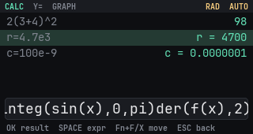
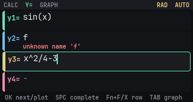
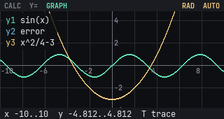

# cardputer-zero-tools

Small native apps for the [M5Stack CardputerZero](https://shop.m5stack.com/pages/m5-cardputerzero)
(Raspberry Pi CM0, Debian 13, 320×170 screen, 46-key keyboard). C++17 + LVGL 9.5, packaged as
`.deb` for the stock APPLaunch launcher.

| App | What it is |
|---|---|
| [`calc`](apps/calc) | Engineering calculator: expressions, variables, user functions, calculus, function graphs with trace / roots / extrema |

## Calc

| | |
|---|---|
|  |  |
|  |  |
|  |  |

- **Fast input**: `Space` completes names (`sq` → `sqrt(|)`, again cycles `sin(` → `sinh(` → `sign(`;
  user functions and variables first), `(` inserts a `()` pair, `)` steps over an existing one,
  Backspace removes an empty pair.
- **Expressions**: `+ - * / % ^ !`, implicit multiplication (`2pi`, `3(x+1)`, `2sqrt(2)`),
  `0x1F`, `0b101`, `1e-3`; a leading operator continues from `ans` (`*2`), missing `)` are closed
  on Enter, empty Enter repeats the last calculation.
- **Functions**: trig (DEG/RAD), hyperbolic, `sqrt cbrt root(x,n) exp ln log log(b,x) log2`,
  `floor ceil round(x,n) trunc sign mod min max hypot gamma gcd lcm ncr npr`, `n!`.
- **Variables and functions**: `r = 4.7e3`, `f(x) = x^3 - 2x`, `area(r) = pi r^2`.
- **Calculus** (expression in `x`): `der(f(x), 2)`, `integ(sin(x), 0, pi)`, `solve(x^2-2, 1)`,
  `solve(cos(x)-x, 0, 1)`, `sum(1/x^2, 1, 100)`.
- **Graphs**: four slots (`Y=` page), pan / zoom / fit, trace with `y` and `y'`, root (`R`) and
  min/max (`M`) search near the cursor.
- Number formats AUTO / SCI / ENG (`F3`), DEG / RAD (`F2`), dark / light theme (`F4`).
  History, variables, functions and plots persist in `~/.config/cz-calc/`.

Keys: `Tab` switches CALC → Y= → GRAPH, `Fn+H` shows help for the current page, hold `Esc` quits.
Operators live on the Sym layer (blue legends): `+` T, `-` R, `*` 8, `/` N, `^` 6, `(` 9, `)` 0, `.` B.

## Layout

```
common/          czkit: shared runtime for all apps (from the official Template, MIT)
  src/app/       Runtime (display, theme, toast, main loop, scripted runs), assets, simulator
  src/platform/  keyboard: evdev decoder (CardputerZero Sym map), repeat/long-press routing
apps/<app>/      one directory per app: core/ (pure C++, host-tested), src/ (LVGL UI), assets/
cmake/           cz_package_app(): install layout + Debian package
docker/          debian:trixie arm64 build image (native on Apple Silicon)
scripts/cz       dev helper
```

## Development

Requirements (macOS): `brew install cmake ninja libpng jpeg-turbo fmt sdl2 freetype zlib dpkg`, Docker.

```sh
scripts/cz sim calc      # desktop simulator (SDL, device-sized screen + clickable keyboard)
scripts/cz test          # host tests: calculator core + keyboard decoder
scripts/cz shots calc    # re-render the screenshots above from apps/calc/demo.script
scripts/cz deb calc      # arm64 .deb in Docker -> dist/
scripts/cz push calc     # build, copy and install on the device (CZ_HOST=pi@<ip>)
```

If Mono.framework (or another framework with an old `png.h`) is installed, configure with
`-DCMAKE_FIND_FRAMEWORK=LAST`, e.g. via a `CMakeUserPresets.json` preset `mac` that inherits
`darwin-arm64`.

**Scripted runs.** Every app understands `CZ_SCRIPT`, a key sequence with `{enter} {tab} {esc}
{up} {f2} {wait:ms} {shot:path.png} {quit}` tokens. It drives the screenshots and smoke tests on
the device:

```sh
ssh pi@<ip> "CZ_SCRIPT='2+2{enter}{shot:/tmp/s.png}{quit}' cz-calc"
```

### CI and releases

`.github/workflows/build.yml` runs on every push / PR: host tests and an arm64 `.deb` per app,
built on GitHub's arm64 runner inside `debian:trixie` (artifacts on the run page).

Release an app by bumping its version in `apps/<app>/CMakeLists.txt` and pushing a matching tag:

```sh
git tag calc-v0.2.0 && git push origin calc-v0.2.0
```

The workflow checks that the tag matches the version and publishes a GitHub release with the `.deb`.
Install on the device: `sudo apt install ./cz-calc_<version>-1_arm64.deb`.

### Publishing to the CardputerZero Store

Each app keeps its listing in `apps/<app>/app-builder.json` (`store` section: summary, categories,
screenshots from `apps/<app>/screenshots/`, a 256×256 icon in `apps/<app>/packaging/`, share code,
permissions). Publishing uses the official [`czdev`](https://github.com/CardputerZero/AppBuilder) CLI:

```sh
git clone https://github.com/CardputerZero/AppBuilder ~/Developer/cz-appbuilder
~/Developer/cz-appbuilder/czdev login                      # GitHub device flow, once
scripts/cz deb calc && scripts/cz store-check calc          # optional pre-check against the registry rules
cd apps/calc && ~/Developer/cz-appbuilder/czdev publish --deb ../../dist/cz-calc_0.2.0-1_arm64.deb
```

`czdev publish` uploads the `.deb` and opens a metadata PR against
[CardputerZero/packages](https://github.com/CardputerZero/packages). The **first** release of an app is
merged by a maintainer after a short video of it running on a real device is posted in the PR;
later versions merge automatically once validation passes (the version must increase — bump it in
`CMakeLists.txt` and `app-builder.json` together, CI checks they agree).

### Adding an app

1. `apps/<name>/CMakeLists.txt` with an executable linked to `czkit` and a `cz_package_app(...)` call
   (see `apps/calc`).
2. `main.cpp`: `cz::Runtime rt("cz-<name>", DEV_ASSETS); rt.init();`, build the UI on
   `lv_screen_active()`, `rt.set_key_handler(...)`, `rt.run()`.
3. `scripts/cz sim <name>` / `scripts/cz deb <name>`.

## Credits

- Runtime, simulator and build files derive from the
  [CardputerZero Template](https://github.com/CardputerZero/Template) (MIT, M5Stack).
- Keyboard symbol map: `/usr/share/keymaps/tca8418_keypad_m5stack_keymap.map`, cross-checked with the
  [community app guide](https://github.com/Prophet60191/m5stack-cardputer-zero-app-guide).
- [JetBrains Mono](https://github.com/JetBrains/JetBrainsMono) (OFL 1.1), Phosphor icons (MIT).
