# cardputer-zero-tools

Small native apps for the [M5Stack CardputerZero](https://shop.m5stack.com/pages/m5-cardputerzero)
(Raspberry Pi CM0, Debian 13, 320×170 screen, 46-key keyboard). C++17 + LVGL 9.5, packaged as
`.deb` for the stock APPLaunch launcher.

| App | What it is |
|---|---|
| [`calcputer`](apps/calcputer) | **CalcPuter** — engineering calculator: expressions, variables, user functions, calculus, function graphs with trace / roots / extrema |
| [`bitputer`](apps/bitputer) | **BitPuter** — programmer's calculator: 8–64-bit words, HEX/DEC/OCT/BIN at once, editable bit grid, float/char/Unix-time views, CRC & checksums |
| [`ohmputer`](apps/ohmputer) | **OhmPuter** — electronics helper: SMD / capacitor / part markings, resistor colour bands, Ohm's law, dividers with E-series pairs, LED resistor, RC, LC, battery runtime |
| [`serialputer`](apps/serialputer) | **SerialPuter** — serial terminal (UART / RS232 / RS485 modules), Modbus RTU master with register table, polling and address scan, bus sniffer with Modbus labels, log to file |

## CalcPuter (`apps/calcputer`)

| | |
|---|---|
| 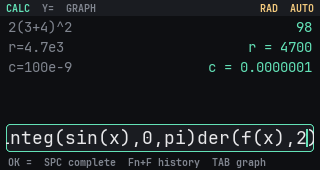 |  |
|  |  |
| 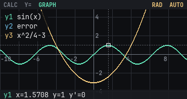 | 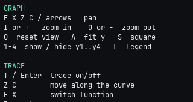 |

- **Fast input**: `Space` completes names (`sq` → `sqrt(|)`, again cycles `sin(` → `sinh(` → `sign(`;
  user functions and variables first), `(` inserts a `()` pair, `)` steps over an existing one,
  Backspace removes an empty pair.
- **Expressions**: `+ - * / % ^ !`, implicit multiplication (`2pi`, `3(x+1)`, `2sqrt(2)`),
  `0x1F`, `0b101`, `1e-3`; a leading operator continues from `ans` (`*2`), missing `)` are closed
  on Enter, empty Enter repeats the last calculation.
- **Functions**: trig (DEG/RAD), hyperbolic, `sqrt cbrt root(x,n) exp ln log log(b,x) log2`,
  `floor ceil round(x,n) trunc sign mod min max hypot gamma gcd lcm ncr npr`, `n!`.
- **Variables and functions**: `r = 4.7e3`, `f(x) = x^3 - 2x`, `area(r) = pi r^2`.
- **Calculus** (expression in `x`): `der(f(x), 2)`, `integ(sin(x), 0, pi)`, `solve(x^2-2, 1)`,
  `solve(cos(x)-x, 0, 1)`, `sum(1/x^2, 1, 100)`.
- **Graphs**: four slots (`Y=` page), pan / zoom / fit, trace with `y` and `y'`, root (`R`) and
  min/max (`M`) search near the cursor.
- Number formats AUTO / SCI / ENG (`F3`), DEG / RAD (`F2`), dark / light theme (`F4`).
  History, variables, functions and plots persist in `~/.config/cz-calcputer/`.

Keys: `Tab` switches CALC → Y= → GRAPH, `Fn+H` shows help for the current page, hold `Esc` quits.
Operators live on the Sym layer (blue legends): `+` T, `-` R, `*` 8, `/` N, `^` 6, `(` 9, `)` 0, `.` B.

## BitPuter (`apps/bitputer`)

| | |
|---|---|
| 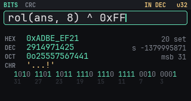 | 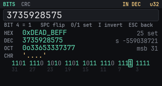 |
| 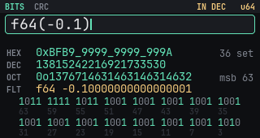 | 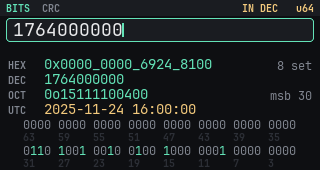 |
| 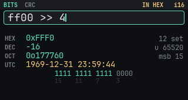 | 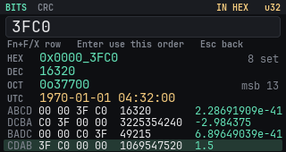 |
| 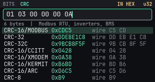 | 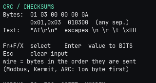 |
| 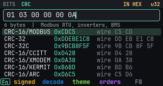 | |

- **Words**: 8 / 16 / 32 / 64 bits (`F3`), unsigned or two's-complement signed (`F4`); every
  operation wraps like a register. The value is shown in HEX, DEC (plus the other signedness),
  OCT and as a bit grid, with popcount and MSB.
- **Expressions** with C precedence: `| ^ & << >> >>> + - * / % ~ **`; `>>` is arithmetic in signed
  mode, `>>>` always logical. Input base DEC / HEX / BIN / OCT (`F2`; in HEX mode `ff` is a number),
  literals `0xFF 0o17 0b101 0n10 'A' 'RIFF' 1_000 4K 2M f32(1.5) f64(0.1)`, variables, `ans`,
  history (`Fn+F`/`Fn+X`), a leading operator continues from `ans` (`&0xF0`, `>>4`).
- **Functions**: `popcnt clz ctz parity bswap bswap16 wswap rev bit mask(n) mask(hi,lo) field(x,hi,lo) set clr tgl
  rol ror sext zext u8..u32 i8..i32 abs min max align isqrt log2 gcd`.
- **Bit grid** (`Fn+X` from the input): move with `Z`/`C`, `Space` flips, `0`/`1` set, `I` inverts.
- **Byte orders** (`F7` instead of the bit grid): the value as ABCD (as is / big-endian), DCBA
  (little-endian), BADC (bytes swapped in 16-bit words) and CDAB (words swapped, the usual Modbus float
  layout), each with its bytes, decimal and float; `Fn+X`, pick a row, `Enter` takes that order.
  Functions `bswap` (BE ↔ LE), `bswap16`, `wswap`.
- **Another reading** of the same bits (`F5`): ASCII chars, IEEE-754 float / double, Unix time
  (seconds or milliseconds, UTC).
- **CRC page** (`Tab`): hex bytes or `"text\r\n"` → CRC-16/MODBUS, CRC-32, CRC-32C,
  CRC-16/CCITT-FALSE, XMODEM, KERMIT, ARC, CRC-8, CRC-8/MAXIM (1-Wire), CRC-8/NRSC-5 (Sensirion),
  XOR8 (NMEA), SUM8 — each with the bytes in wire order; `Enter` sends the value to the BITS page.

State persists in `~/.config/cz-bitputer/`. `F6` toggles the theme, `F1` shows help.

## OhmPuter (`apps/ohmputer`)

| | |
|---|---|
| 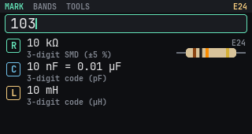 | 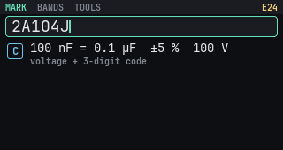 |
| 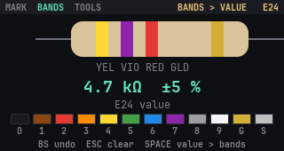 | 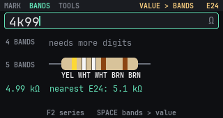 |
| 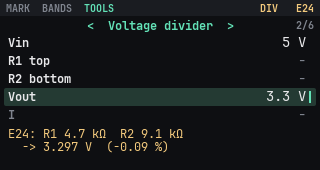 | 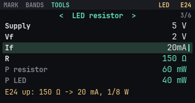 |
| 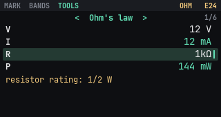 | 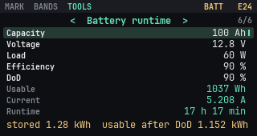 |

- **MARK** — type what is printed on a part and get every plausible reading: SMD resistors (`103`, `4992`,
  `4R7`, `R47`, EIA-96 `01C`), capacitors (`104`, `229`, `4n7`, `104K`, `2A104J` with EIA voltage and
  tolerance letters), tantalum (`A106` = 10 µF 10 V), inductors (`101`, `4R7`) and a short list of common
  SMD diode / transistor codes (`M1`–`M7`, `T4`, `A7`, `1AM`, `J3Y`…; codes vary by maker). Resistor readings
  also show their colour code and whether the value is in the selected E-series.
- **BANDS** — colours are typed as the digit they stand for (`4 7 2 G` = yellow violet red gold), 3–6 bands,
  value + tolerance + tempco, reversed reading when the first band is gold/silver. `Space` flips to
  value → 4- and 5-band codes.
- **TOOLS** (`Fn+Z`/`Fn+C` switch): Ohm's law (any two of V I R P), voltage divider (any three, or Vin + Vout →
  best E-series pair), LED resistor (rounded up to the series, with power rating), RC time constant / cut-off,
  LC resonance, battery runtime (capacity, voltage, load, efficiency, DoD). Values take SI prefixes:
  `4k7 2u2 10m 1e-3`. Typing one input too many clears the oldest one.
- `F2` cycles E6 / E12 / E24 / E48 / E96, `F6` theme, `F1` help. State persists in `~/.config/cz-ohmputer/`.

## SerialPuter (`apps/serialputer`)

| | |
|---|---|
| 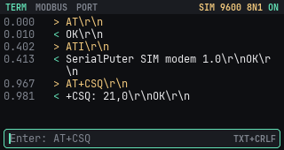 | 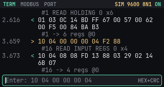 |
| 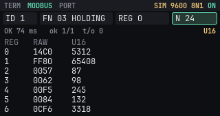 | 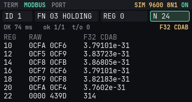 |
| 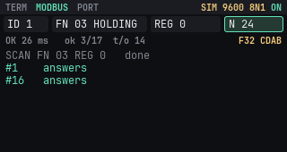 | 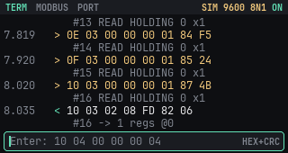 |
| 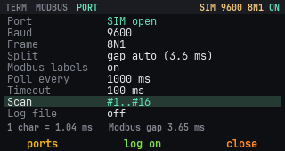 | 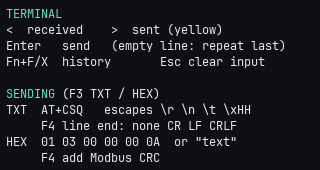 |

- **TERM** — frames as they arrive (`<` received, `>` sent) with time since start or between frames. A pause on the
  line ends a frame (automatic Modbus 3.5-character gap, or fixed) or LF does (line mode). Views HEX / TXT / DUMP
  (`F2`). Send typed text with escapes `\r \n \xHH` and a line end (none / CR / LF / CRLF), or bytes
  (`01 03 00 00 00 0A`, optionally with the Modbus CRC appended). Enter on an empty line repeats the last one,
  `F7` holds the view to scroll back, `F9` writes everything to `~/.config/cz-serialputer/logs/`.
  Valid Modbus RTU frames get a label (`#1 READ HOLDING 0 x10`, `#1 -> 10 regs @0`, exceptions), glued
  request + response frames are split by CRC — handy for sniffing a BMS ↔ inverter link.
- **MODBUS** — read coils / discrete inputs / holding / input registers (FC 01–04): ID, function, register, count;
  `Enter` reads once, `F3` polls, `F5` scans addresses for anything that answers (exceptions count as an answer).
  Values as U16 / I16 / HEX / U32 / I32 / F32 with ABCD or CDAB word order. Read-only: nothing is written.
- **PORT** — port (`SIM` demo bus, `serial0`, USB adapters), baud 1200–921600, 8N1 / 8E1 / 8O1 / 8N2 / 7E1 / 7O1,
  frame split, poll period, timeout, scan range, log file.
- `SIM` is a pretend line with a battery BMS at #1, an inverter at #16 and a modem (`AT`, `ATI`, `AT+CSQ`): the
  desktop simulator and the screenshots use it.
- Wiring: the header UART (GPIO14 TX / GPIO15 RX, `/dev/serial0` → `ttyS0`) is on the Grove port in its default
  UART mode (yellow = TX out, white = RX in) and on EXT pins 14 / 12. It is the Pi **mini UART**: 8N1 / 7N1 only,
  no parity — use a USB-RS485 adapter for 8E1 devices. Logic is 3.3 V: a module powered from 5 V needs a divider
  on its TX line.

## Layout

```
common/          czkit: shared runtime for all apps (from the official Template, MIT)
  src/app/       Runtime (display, theme, toast, main loop, scripted runs), assets, simulator
  src/platform/  keyboard: evdev decoder (CardputerZero Sym map), repeat/long-press routing
  src/view/      ui_style: shared colours and JetBrains Mono fonts (assets/fonts)
  core/          czcore: pure C++ helpers for app cores (line editor, byte strings + CRCs)
apps/<app>/      one directory per app: core/ (pure C++, host-tested), src/ (LVGL UI), assets/
cmake/           cz_package_app(): install layout + Debian package
docker/          debian:trixie arm64 build image (native on Apple Silicon)
scripts/cz       dev helper
```

## Development

Requirements (macOS): `brew install cmake ninja libpng jpeg-turbo fmt sdl2 freetype zlib dpkg`, Docker.

```sh
scripts/cz sim calcputer      # desktop simulator (SDL, device-sized screen + clickable keyboard)
scripts/cz test calcputer     # host tests: the app core + keyboard decoder
scripts/cz shots calcputer    # re-render the screenshots above from apps/calcputer/demo.script
scripts/cz deb calcputer      # arm64 .deb in Docker -> dist/
scripts/cz push calcputer     # build, copy and install on the device (CZ_HOST=pi@<ip>)
```

If Mono.framework (or another framework with an old `png.h`) is installed, configure with
`-DCMAKE_FIND_FRAMEWORK=LAST`, e.g. via a `CMakeUserPresets.json` preset `mac` that inherits
`darwin-arm64`.

**Scripted runs.** Every app understands `CZ_SCRIPT`, a key sequence with `{enter} {tab} {esc}
{up} {f2} {wait:ms} {shot:path.png} {quit}` tokens. It drives the screenshots and smoke tests on
the device:

```sh
ssh pi@<ip> "CZ_SCRIPT='2+2{enter}{shot:/tmp/s.png}{quit}' cz-calcputer"
```

### CI and releases

`.github/workflows/build.yml` runs on every push / PR: host tests and an arm64 `.deb` per app,
built on GitHub's arm64 runner inside `debian:trixie` (artifacts on the run page).

Release an app by bumping its version in `apps/<app>/CMakeLists.txt` and pushing a matching tag:

```sh
git tag calcputer-v0.3.0 && git push origin calcputer-v0.3.0
```

The workflow checks that the tag matches the version and publishes a GitHub release with the `.deb`.
Install on the device: `sudo apt install ./cz-calcputer_<version>-1_arm64.deb`.

### Publishing to the CardputerZero Store

Each app keeps its listing in `apps/<app>/app-builder.json` (`store` section: summary, categories,
screenshots from `apps/<app>/screenshots/`, a 256×256 icon in `apps/<app>/packaging/`, share code,
permissions). Publishing uses the official [`czdev`](https://github.com/CardputerZero/AppBuilder) CLI:

```sh
git clone https://github.com/CardputerZero/AppBuilder ~/Developer/cz-appbuilder
~/Developer/cz-appbuilder/czdev login                      # GitHub device flow, once
scripts/cz deb calcputer && scripts/cz store-check calcputer          # optional pre-check against the registry rules
cd apps/calcputer && ~/Developer/cz-appbuilder/czdev publish --deb ../../dist/cz-calcputer_0.3.0-1_arm64.deb
```

`czdev publish` uploads the `.deb` and opens a metadata PR against
[CardputerZero/packages](https://github.com/CardputerZero/packages). The **first** release of an app is
merged by a maintainer after a short video of it running on a real device is posted in the PR;
later versions merge automatically once validation passes (the version must increase — bump it in
`CMakeLists.txt` and `app-builder.json` together, CI checks they agree).

### Adding an app

1. `apps/<name>/CMakeLists.txt` with an executable linked to `czkit` and a `cz_package_app(...)` call
   (see `apps/calcputer`).
2. `main.cpp`: `cz::Runtime rt("cz-<name>", DEV_ASSETS); rt.init();`, build the UI on
   `lv_screen_active()`, `rt.set_key_handler(...)`, `rt.run()`.
3. `scripts/cz sim <name>` / `scripts/cz deb <name>`.

## Credits

- Runtime, simulator and build files derive from the
  [CardputerZero Template](https://github.com/CardputerZero/Template) (MIT, M5Stack).
- Keyboard symbol map: `/usr/share/keymaps/tca8418_keypad_m5stack_keymap.map`, cross-checked with the
  [community app guide](https://github.com/Prophet60191/m5stack-cardputer-zero-app-guide).
- [JetBrains Mono](https://github.com/JetBrains/JetBrainsMono) (OFL 1.1), Phosphor icons (MIT).
